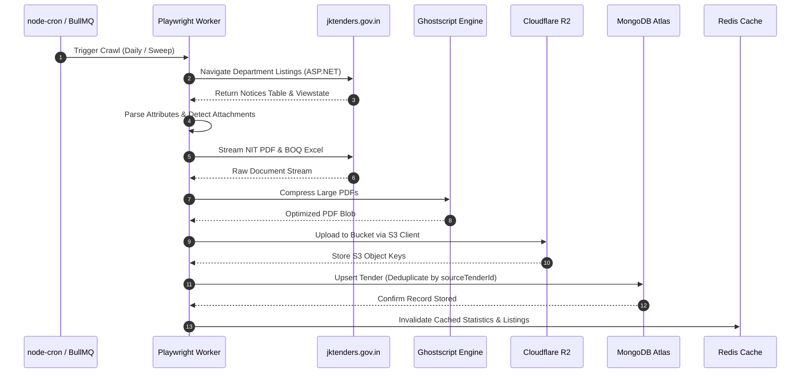
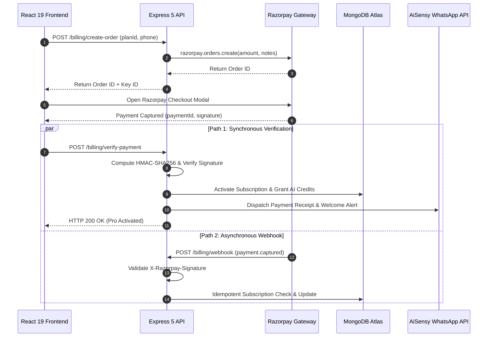
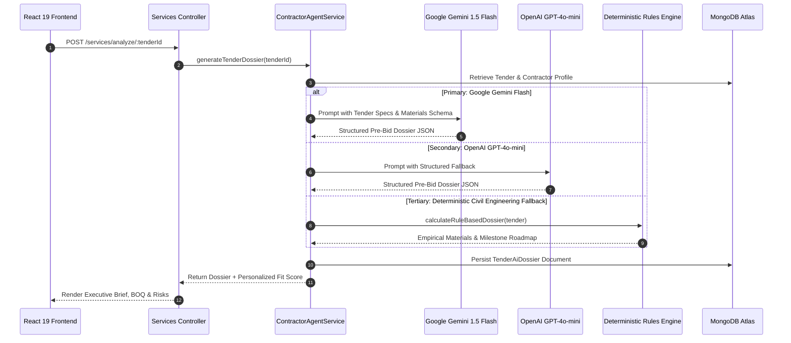

# TenderHub — Public Procurement Intelligence & Contractor AI Platform

TenderHub is an enterprise platform engineered to automate the discovery, ingestion, cloud archival, qualification scoring, and AI-assisted bid analysis of government tenders in India, with primary production crawlers configured for the NIC-GEP infrastructure (`jktenders.gov.in`).

The platform bridges the information gap between complex government portals and civil contractors through automated web crawling, zero-egress cloud document storage, an empirical bid capacity calculator, a multi-tiered contractor AI intelligence engine, and real-time WhatsApp dispatches.

---

## Live Deployments

| Component | Environment | URL |
| :--- | :--- | :--- |
| **Frontend Web Application** | Production (Render Static Site) | [https://tenderhub-frontend-ur7t.onrender.com/](https://tenderhub-frontend-ur7t.onrender.com/) |
| **Backend REST API** | Production (Render Web Service) | `https://tenderhub-backend-jofq.onrender.com` |
| **API Health Check** | Production | `https://tenderhub-backend-jofq.onrender.com/health` |

---

## Table of Contents

1. [Executive Overview & Problem Statement](#executive-overview--problem-statement)
2. [Key Capabilities & System Architecture](#key-capabilities--system-architecture)
3. [Repository Structure](#repository-structure)
4. [Technology Stack](#technology-stack)
5. [Comprehensive Feature Inventory](#comprehensive-feature-inventory)
   - [Public Tender Discovery & Analytics](#1-public-tender-discovery--analytics-tenders)
   - [Detailed Tender Inspection & Cover Checklists](#2-detailed-tender-inspection--cover-checklists-tendersid)
   - [Bid Score & Capacity Assessment Engine](#3-bid-score--capacity-assessment-engine-check-score)
   - [Contractor AI Engineering & Intelligence Hub](#4-contractor-ai-engineering--intelligence-hub-services)
   - [Contractor Workspace & Portfolio Management](#5-contractor-workspace--portfolio-management-profile)
   - [Pro Subscriptions & Billing Engine](#6-pro-subscriptions--billing-engine-pricing)
   - [Multi-Channel Notification Dispatch](#7-multi-channel-notification-dispatch)
   - [Security, BotShield & High-Availability Resilience](#8-security-botshield--high-availability-resilience)
   - [Isolated Administrative Console](#9-isolated-administrative-console-admin-panel)
6. [System Data Flows](#system-data-flows)
7. [API Route Reference](#api-route-reference)
8. [Environment Configuration](#environment-configuration)
9. [Local Development Setup](#local-development-setup)
10. [Master Commands Reference](#master-commands-reference)
11. [Production Deployment Guide](#production-deployment-guide)
12. [Documentation & Handover Index](#documentation--handover-index)

---

## Executive Overview & Problem Statement

Government procurement portals built on legacy ASP.NET viewstate architectures present severe operational friction for construction firms, engineering contractors, and procurement analysts:

- **Navigational Inefficiencies**: Notices are fragmented across multi-level organizational hierarchies, dynamic dropdowns, and CAPTCHA-gated paginations.
- **Critical Document Bottlenecks**: Important Notice Inviting Tender (NIT) and Bill of Quantities (BOQ) files are stored across unindexed links that frequently suffer timeouts and downtime.
- **Complex Bidding Qualifications**: Contractors routinely expend substantial billable engineering hours manually extracting turnover requirements, solvency thresholds, equipment compliance, and material quantities from 50+ page specifications.
- **Missed Opportunities**: Delayed notice awareness frequently causes missed submission deadlines, corrigendum oversights, and bid forfeiture.

TenderHub solves these problems through an automated, cloud-native architecture:
1. **Automated Ingestion**: Headless Playwright workers crawl departmental catalogs, solve session challenges, parse multi-cover tables, compress oversized PDFs using Ghostscript, and archive assets to Cloudflare R2.
2. **Empirical Eligibility Assessment**: Algorithmic bid capacity calculations evaluate contractor turnover, solvency, ongoing liabilities, and machinery readiness before bidding resources are committed.
3. **Multi-Tiered Contractor AI**: Pre-bid dossiers, raw material schedules (cement, steel, bitumen, aggregate), risk flags, and post-award milestone roadmaps are compiled using Google Gemini Flash and OpenAI with deterministic rule-based engineering fallbacks.
4. **Targeted Dispatches**: Real-time WhatsApp notifications send matching notices, corrigenda, and price schedules directly to field contractors.

---

## Key Capabilities & System Architecture

```
+-----------------------------------------------------------------------------------+
|                              GOVERNMENT TENDER PORTAL                              |
|                           (jktenders.gov.in / NIC-GEP)                            |
+-----------------------------------------------------------------------------------+
                                           |
                                           | Headless Playwright Ingestion
                                           v
+-----------------------------------------------------------------------------------+
|                             TENDERHUB CRAWLER ENGINE                              |
|  - Multi-department table traversal & ASP.NET viewstate handling                  |
|  - CAPTCHA bypass (CapSolver / TrueCaptcha / OCR fallback)                        |
|  - NIT / BOQ PDF extraction & Ghostscript compression                             |
+-----------------------------------------------------------------------------------+
        |                                                   |
        | Document Blobs                                    | Structured JSON Data
        v                                                   v
+-----------------------+                         +----------------------------------+
|    CLOUDFLARE R2      |                         |         MONGODB CLUSTER          |
|  (Primary + Mirror)   |                         |  - Tenders, Users, Subscriptions |
|  Presigned Downloads  |                         |  - AI Dossiers, Audit Logs       |
+-----------------------+                         +----------------------------------+
                                                            |
                                                            | Cached Queries & Stats
                                                            v
+-----------------------------------------------------------------------------------+
|                                REDIS CACHE & QUEUE                                |
|  - Aggregated stats (total value, active counts, department summaries)            |
|  - BullMQ job queues (crawlers, notification dispatch)                            |
|  - Rate limiting & BotShield IP tracking                                          |
+-----------------------------------------------------------------------------------+
                                           |
                                           | REST API (JSON)
                                           v
+-----------------------------------------------------------------------------------+
|                               EXPRESS 5 REST API                                  |
|  - Auth: JWT + Google OAuth2                                                      |
|  - Tenders: Search, filters, pagination, saved tenders                            |
|  - Billing: Razorpay checkout, subscription management, webhooks                  |
|  - Notifications: AiSensy WhatsApp alerts dispatch                                |
|  - AI Services: Contractor dossier generation, Copilot chat                       |
+-----------------------------------------------------------------------------------+
        |                                                   |
        | Client Interactions                               | Server-to-Server Hooks
        v                                                   v
+-----------------------+                         +----------------------------------+
|     REACT 19 SPA      |                         |       THIRD-PARTY SERVICES       |
|  (Vite + Tailwind)    |                         |  - Razorpay (Webhooks)           |
|  Desktop & Mobile     |                         |  - AiSensy (WhatsApp Business)   |
+-----------------------+                         |  - Google Gemini / OpenAI (LLM)  |
                                                  |  - Telegram Bot (Backup alerts)  |
                                                  +----------------------------------+
```

---

## Repository Structure

TenderHub is organized as a decoupled monorepo:

```
tenderHub/
├── backend/                               # REST API & background services
│   ├── src/
│   │   ├── app.js                         # Express middleware, security, and route registry
│   │   ├── server.js                      # Server bootstrap, DB connections, and cron scheduler
│   │   ├── config/                        # Database failover, Redis, environment, and R2 configs
│   │   ├── controllers/                   # Request controllers (Auth, Tenders, Admin, AI)
│   │   ├── middleware/                    # BotShield, JWT auth, RBAC, rate-limiting, error handler
│   │   ├── models/                        # Mongoose schemas (Tender, User, AiDossier, etc.)
│   │   ├── modules/
│   │   │   ├── billing/                   # Razorpay orders, subscriptions, and webhook handling
│   │   │   └── notifications/             # AiSensy WhatsApp engine and matching workers
│   │   ├── routes/                        # API routes (/api/v1/*)
│   │   ├── scripts/                       # Crawl runners, PDF generators, maintenance tools
│   │   ├── services/                      # Scrapers, adapters, AI service, cache, backup
│   │   ├── utils/                         # Token helpers, R2 presigners, date normalizers
│   │   └── workers/                       # BullMQ queue consumers
│   ├── .env                               # Server environment variables
│   └── package.json
│
├── frontend/                              # Client Single-Page Application (SPA)
│   ├── src/
│   │   ├── assets/                        # Static brand assets and graphics
│   │   ├── components/                    # UI elements, layout shell, modals, meters
│   │   ├── context/                       # Theme and global UI providers
│   │   ├── hooks/                         # React Query hooks and debounce utilities
│   │   ├── pages/                         # Route views (Home, Tenders, Services, Score, Pricing)
│   │   ├── services/                      # Axios API clients
│   │   ├── store/                         # Zustand state stores (auth, bookmarks, preferences)
│   │   ├── utils/                         # Number, currency, and date formatters
│   │   ├── App.jsx                        # Root React layout and route definitions
│   │   └── main.jsx                       # Application entry point
│   ├── .env.production                    # Production API endpoints for Render
│   └── package.json
│
├── admin-panel/                           # Dedicated administrative monitoring interface
│   ├── src/
│   │   ├── components/                    # Admin views (Telemetry, Ingestion, Logs, Backups)
│   │   ├── services/                      # Admin API client
│   │   └── App.jsx                        # Admin console layout
│   └── package.json
│
├── docs/                                  # Developer manuals, architecture guides, and costings
│   ├── DEVELOPER_HANDOVER_MANUAL.md       # Master engineering handover manual
│   ├── AI_AGENT_ROADMAP_AND_MODIFICATIONS.md # AI engine architecture and Gemini activation
│   ├── INFRASTRUCTURE_COSTS_AND_PRICING.md # Production cost breakdown across cloud tiers
│   ├── SYSTEM_DATA_FLOW_AND_ARCHITECTURE.md # Sequence diagrams and data lifecycles
│   └── ALL_COMMANDS_CHEAT_SHEET.md        # CLI commands and operational runbook
│
├── DEPLOYMENT_GUIDE.md                    # Render deployment walkthrough
├── render.yaml                            # 1-Click Infrastructure Blueprint for Render
└── README.md                              # Master repository guide
```

---

## Technology Stack

### Backend Services
| Layer | Technology | Details |
| :--- | :--- | :--- |
| **Runtime & Framework** | Node.js (v20+ ES Modules), Express.js 5 | REST API server with structured routing, controllers, and middleware |
| **Primary Database** | MongoDB Atlas, Mongoose 9 | Document storage for tenders, users, AI dossiers, and subscriptions |
| **Database Failover** | Secondary MongoDB Replica | Automatic fallback connection via `SECONDARY_MONGO_URI` |
| **Caching & Queues** | Redis (Upstash / Local), BullMQ 6, ioredis 6 | Distributed queue processing, aggregation caching, and rate limiting |
| **Browser Automation** | Playwright (Chromium) | Headless browser crawler for NIC-GEP portal traversal |
| **PDF Processing** | Ghostscript (`gswin64c` / `gs`), pdf-parse | Compresses high-resolution tender PDFs before cloud upload; extracts text |
| **Cloud Storage** | Cloudflare R2 (`@aws-sdk/client-s3`) | S3-compatible zero-egress object storage for NIT and BOQ archives |
| **AI LLM Services** | Google Gemini (`@google/generative-ai`), OpenAI | Pre-bid dossier compilation, material extraction, and Copilot chat |
| **Payment Gateway** | Razorpay Node.js SDK | Order generation, subscription management, and webhook verification |
| **Messaging & Alerts** | AiSensy (WhatsApp Business API) | Automated tender alert dispatches and payment confirmation receipts |
| **Security & Logging** | Helmet, bcryptjs, jsonwebtoken, Pino | Security headers, password hashing, JWT auth, and structured JSON logs |

### Frontend Application
| Layer | Technology | Details |
| :--- | :--- | :--- |
| **Core Framework** | React 19, Vite 8 | High-performance client-side Single Page Application |
| **Styling & Design System** | Tailwind CSS 3.4, PostCSS, Framer Motion | Modern UI, responsive typography, dark/light themes, smooth transitions |
| **State Management** | Zustand 5 | Modular client stores: `useAuthStore`, `useBookmarkStore`, `usePreferenceStore` |
| **Data Fetching & Cache** | TanStack React Query 5, Axios | Automated query caching, background refetching, and request interceptors |
| **Routing** | React Router v7 | Client-side routing with deep link parameters and scroll restoration |
| **Icons & Visuals** | Lucide React | Modern, lightweight icon suite |

---

## Comprehensive Feature Inventory

### 1. Public Tender Discovery & Analytics (`/tenders`)
- **Full-Text Search Engine**: Real-time multi-field search across notice titles, source tender IDs, tender reference numbers, and work descriptions with debounce optimization.
- **Multi-Dimensional Filters**:
  - **All 20 Administrative Districts**: Anantnag, Bandipora, Baramulla, Budgam, Doda, Ganderbal, Jammu, Kathua, Kishtwar, Kulgam, Kupwara, Poonch, Pulwama, Rajouri, Ramban, Reasi, Samba, Shopian, Srinagar, and Udhampur.
  - **Procurement Types**: Works Contracts (Civil / Engineering), Goods & Equipment Supplies, and Services & Operations.
  - **38+ Work Categories**: Civil Works (Buildings, Roads, Macadamization, Canals, Water Works), Electrical Works, Drilling Works, Mechanical Items, Agricultural/Forestry, Medical Equipment, and Consultancy.
  - **Department & Organization Chains**: Filter by issuing authority (PWD, Jal Shakti / PHE, PMGSY, PDD, Health & Medical Education, Forest Dept, etc.).
  - **Tender Status**: Active, Closing Soon (within 48 hours), Expired, or All.
  - **Contract Value Slider**: Dynamic numeric bounds filtering min and max tender values.
  - **Multi-Field Sorting**: Order by submission deadline (ascending/descending) or estimated tender value.
- **Dynamic Aggregate Metrics**: Real-time counter cards displaying total active notices, aggregate value in Crores INR, urgent closing counts, and monitored departments.
- **Multi-Tender Grouping**: Automatically identifies and groups sibling works published under a common Notice Inviting Tender (NIT).

### 2. Detailed Tender Inspection & Cover Checklists (`/tenders/:id`)
- **Comprehensive Notice Overview**: Displays estimated contract value, earnest money deposit (EMD), tender document fee, period of work, project location, and issuing division.
- **Critical Milestone Dates**: Published date, document download start/end dates, bid submission window, and bid opening schedule.
- **Document Cover Breakdown**: Exact cover requirements (Fee Cover, Pre-Qualification Cover, Technical Cover, and Financial Cover) with expected file formats.
- **Offline Instrument Specifications**: Acceptable payment instruments (Bank Guarantee, CDR, FDR) with designated payable-to and payable-at authorities.
- **Bidder Eligibility Checklist**: Mandatory statutory documents, GST clearance certificates, contractor registration card renewal, and experience criteria.
- **Cloud Document Access**: Direct, authenticated download of compressed NIT documents and BOQ spreadsheets stored in Cloudflare R2.

### 3. Bid Score & Capacity Assessment Engine (`/check-score`)
- **Empirical Bidding Capacity Calculator**: Evaluates bidder eligibility against standard public works formulas:
  $$\text{Bid Capacity} = (A \times N \times 2) - B$$
  Where $A$ is the maximum annual turnover in the last 5 years, $N$ is the completion period in years, and $B$ is the value of existing ongoing commitments.
- **Financial Threshold Validation**: Compares tender requirements with contractor turnover ratios, bank solvency limits, and largest single completed contract.
- **Operational Readiness Checklist**: Validates equipment/machinery ownership, valid GST clearance status, valid contractor registration renewal, and active CDR/FDR bank facilities.
- **Visual Speedometer Gauge**: Real-time eligibility score visualization (0 to 100) with color-coded risk bands (High Probability, Moderate Probability, High Disqualification Risk).
- **Personalized Bid Recommendations**: Guidance on margin bidding, joint venture requirements, and necessary CDR adjustments.
- **Evaluation History**: Stores historical assessments in MongoDB (`BidEvaluation`) for reference and audit tracking.

### 4. Contractor AI Engineering & Intelligence Hub (`/services`)
- **Pre-Bid Tender Dossier**:
  - **Executive Overview**: Scope summary, EMD exemptions, tender fee guidelines, and completion timelines.
  - **Eligibility Checklist**: Required turnover, solvency, experience criteria, minimum registration class, and joint venture rules.
  - **Mandatory Document Matrix**: Comprehensive stage-by-stage document checklist (Fee, Technical, Financial) with compliance tips.
  - **Risks & Red Flags**: Critical alerts for punitive liquidated damages, strict forfeiture terms, harsh defect liability periods, and price escalation caps.
- **Raw Material & BOQ Schedule**:
  - Itemized material requirements: Cement (bags), Structural Steel (MT), Bitumen (drums/MT), Sand/Aggregate (cum), and Heavy Equipment hours.
  - Approximate market rates and cost allocation summaries based on regional schedule-of-rates (SoR).
- **Post-Award Execution Roadmap**:
  - Phased project breakdown (Mobilization, Substructure, Superstructure, Finishing).
  - Target timeline milestones, critical path benchmarks, and delay penalty warnings.
  - Quality assurance testing standards (IS codes and MoRTH specifications).
- **Interactive Tender Copilot**:
  - Live AI chat assistant enabling contractors to query tender specifications, legal terms, and technical prerequisites.
  - Conversational context maintained in MongoDB (`AiAgentChatSession`).
- **Resilient Multi-Tier AI Architecture**:
  - **Primary**: Google Gemini 1.5 Flash via `@google/generative-ai`.
  - **Secondary**: OpenAI GPT-4o-mini via `openai`.
  - **Tertiary Fallback**: Deterministic civil engineering rules engine (`generateDeterministicEngineeringDossier`) generating realistic material schedules and checklists without external API dependencies.

### 5. Contractor Workspace & Portfolio Management (`/profile`)
- **Company Credentials**: Store company name, registration class (Class A/B/C/D), PAN, GSTIN, and statutory documentation.
- **Financial Profile**: Configure average turnover, bank solvency limits, largest completed projects, and active commitment balances.
- **Machinery & Equipment Registry**: Track owned or leased heavy equipment (excavators, pavers, road rollers, transit mixers).
- **Multi-Stage Saved Tenders**: Organize opportunities through lifecycle stages:
  - Shortlisted
  - Under Analysis
  - Bid Submitted
  - Won / Awarded
  - Archived
- **Daily Access Meter**: Visual quota indicator tracking daily view allowances for free users and Pro members.

### 6. Pro Subscriptions & Billing Engine (`/pricing`)
- **Tiered Subscription Plans**:
  - **Pro Monthly**: Unlimited tender views, instant BOQ Excel downloads, custom WhatsApp alerts, and saved bookmarks.
  - **Pro Quarterly**: All monthly features with seasonal discount pricing for peak construction periods.
  - **Pro Annual**: Maximum value tier for Class A/B engineering firms with priority support.
  - **Contractor AI Bundles**: Quota-based packages providing AI Dossier credits and unlimited Copilot queries.
- **Razorpay Checkout Integration**: Supports UPI, Credit/Debit Cards, NetBanking, and Wallets.
- **Dual-Path Payment Verification**:
  - **Synchronous Verification**: Immediate cryptographic HMAC-SHA256 signature calculation via `/api/v1/billing/verify-payment`.
  - **Asynchronous Webhook Reconciliation**: Background webhook listener (`/api/v1/billing/webhook`) processing `payment.captured` and `order.paid` events with `X-Razorpay-Signature` validation, preventing dropped activations during network timeouts.

### 7. Multi-Channel Notification Dispatch
- **AiSensy WhatsApp Business API**: Sends instant tender alerts, corrigendum notifications, and payment receipts directly to verified contractor mobile numbers.
- **Contractor Preference Engine**: Contractors configure custom notification criteria:
  - Target departments (e.g., PWD, Jal Shakti, PDD)
  - Target districts (e.g., Srinagar, Baramulla, Jammu)
  - Minimum and maximum contract values
  - Keyword filters
- **Background Matching Worker**: Ingestion events trigger matching evaluations against `ContractorPreference` records, dispatching customized alerts asynchronously.

### 8. Security, BotShield & High-Availability Resilience
- **BotShield Anti-Scraping Protection**:
  - Blocks automated scrapers, headless tools, and malicious Python bots via User-Agent inspection.
  - Deploys honeypot traps (`/api/v1/internal/crawler-trap`, `/internal/crawler-trap`) that immediately blacklist offending IPs in Redis for 24 hours.
- **API Rate Limiting**: Redis-backed rate limiters on all public endpoints prevent denial-of-service and credential-stuffing attacks.
- **Double-Token Authentication**:
  - 15-minute short-lived JWT Access Tokens issued via secure `httpOnly` cookies.
  - 7-day long-lived Refresh Tokens stored in MongoDB for seamless renewal.
  - Google OAuth 2.0 single sign-on integration.
- **Role-Based Access Control (RBAC)**: Route-level authorization distinguishing `user`, `contractor`, `admin`, and `owner` roles.
- **Dual Database Failover**:
  - Server maintains active connection to primary MongoDB Atlas cluster.
  - Automatically redirects queries to `SECONDARY_MONGO_URI` if the primary cluster experiences network partition or outage.

### 9. Isolated Administrative Console (`admin-panel`)
- **Telemetry Dashboard**: Real-time metrics for database status, Redis ping latency, memory utilization, and incoming request rates.
- **Ingestion Controls**: Manual trigger actions for daily incremental crawls, full department crawls, or document re-fetch jobs.
- **Archive & Backup Management**: Trigger on-demand database snapshots to local storage and verify Cloudflare R2 mirror synchronization.
- **Diagnostic Tools**: Live verification tools for CAPTCHA solvers, Cloudflare R2 bucket connectivity, and WhatsApp dispatch endpoints.
- **System Logs**: Live viewer for server warnings, errors, and crawler activity.

---

## System Data Flows

### 1. Crawler Ingestion & Document Archival Pipeline



### 2. Dual-Path Payment Reconciliation



### 3. Multi-Tier AI Dossier Generation



---

## API Route Reference

All API routes are mounted under `/api/v1` (with root fallbacks for legacy compatibility).

### Authentication (`/api/v1/auth`)
| Method | Route | Description | Auth Required |
| :--- | :--- | :--- | :--- |
| `POST` | `/register` | Create a new user account | No |
| `POST` | `/login` | Authenticate with email/password and set HTTP-only JWT cookies | No |
| `POST` | `/logout` | Invalidate session cookies | Yes |
| `GET` | `/me` | Retrieve currently authenticated user context | Yes |
| `POST` | `/refresh-token` | Refresh expired access token using refresh token | No |
| `GET` | `/google` | Initiate Google OAuth 2.0 single sign-on | No |
| `GET` | `/google/callback`| OAuth 2.0 redirect receiver | No |

### Public Tenders (`/api/v1/tenders`)
| Method | Route | Description | Auth Required |
| :--- | :--- | :--- | :--- |
| `GET` | `/` | Paginated tender search with multi-dimensional filtering | No |
| `GET` | `/stats` | Aggregated metrics (active notices, total value, closing soon) | No |
| `GET` | `/departments` | List of indexed departments with active notice counts | No |
| `GET` | `/:id` | Full specification details and cover breakdown for a tender | No |

### Contractor Workspace (`/api/v1/contractor`)
| Method | Route | Description | Auth Required |
| :--- | :--- | :--- | :--- |
| `GET` | `/profile` | Retrieve contractor profile, machinery registry, and financials | Yes |
| `PUT` | `/profile` | Update contractor business credentials and equipment | Yes |
| `GET` | `/saved-tenders` | Retrieve all bookmarked tenders grouped by pipeline status | Yes |
| `POST` | `/saved-tenders/:id` | Bookmark a tender or update its pipeline status | Yes |
| `DELETE`| `/saved-tenders/:id` | Remove a tender from contractor bookmarks | Yes |

### Bid Scoring Engine (`/api/v1/bid-score`)
| Method | Route | Description | Auth Required |
| :--- | :--- | :--- | :--- |
| `POST` | `/evaluate` | Calculate empirical bidding score and capacity for a tender | Yes |
| `GET` | `/metrics` | Retrieve stored contractor qualification metrics | Yes |
| `PUT` | `/metrics` | Update contractor qualification metrics | Yes |
| `GET` | `/history` | Retrieve historical bid score evaluations | Yes |
| `DELETE`| `/history/:id` | Delete a specific evaluation record | Yes |

### AI Services & Copilot (`/api/v1/services`)
| Method | Route | Description | Auth Required |
| :--- | :--- | :--- | :--- |
| `GET` | `/plans` | Retrieve available AI credit packages | No |
| `POST` | `/analyze/:tenderId`| Compile or fetch comprehensive Pre-Bid Dossier & BOQ | Yes |
| `POST` | `/chat/:tenderId` | Query the interactive Tender Copilot assistant | Yes |
| `GET` | `/contractor-profile` | Fetch contractor parameters used by the AI engine | Yes |
| `PUT` | `/contractor-profile` | Update contractor parameters used by the AI engine | Yes |

### Billing & Payments (`/api/v1/billing`)
| Method | Route | Description | Auth Required |
| :--- | :--- | :--- | :--- |
| `GET` | `/plans` | Retrieve active subscription tiers and feature matrices | No |
| `GET` | `/status` | Retrieve user active subscription and quota remaining | Yes |
| `POST` | `/create-order` | Generate a signed Razorpay order ID | Yes |
| `POST` | `/verify-payment` | Synchronously verify payment signature and activate Pro | Yes |
| `POST` | `/webhook` | Asynchronous Razorpay webhook receiver | No (Signature Verified) |

### Notifications (`/api/v1/notifications`)
| Method | Route | Description | Auth Required |
| :--- | :--- | :--- | :--- |
| `GET` | `/preferences` | Retrieve user WhatsApp notification criteria | Yes |
| `PUT` | `/preferences` | Update department, district, and value alert criteria | Yes |

### Administration (`/api/v1/admin`)
| Method | Route | Description | Auth Required |
| :--- | :--- | :--- | :--- |
| `GET` | `/stats` | System telemetry (DB connection, Redis, queues, memory) | Admin / Owner |
| `POST` | `/trigger-crawl` | Manually dispatch portal scraper worker | Admin / Owner |
| `POST` | `/trigger-backup` | Manually initiate database archive snapshot | Admin / Owner |

---

## Environment Configuration

### Backend Environment Variables (`backend/.env`)

```env
# Server Runtime
PORT=8000
NODE_ENV=development

# Database Connections
MONGO_URI=mongodb+srv://<username>:<password>@cluster0.mongodb.net/tenderhub?retryWrites=true&w=majority
SECONDARY_MONGO_URI=mongodb+srv://<username>:<password>@cluster1.mongodb.net/tenderhub?retryWrites=true&w=majority
REDIS_URL=redis://127.0.0.1:6379

# JWT Authentication
JWT_ACCESS_SECRET=your_secure_32_char_access_secret_here
JWT_REFRESH_SECRET=your_secure_32_char_refresh_secret_here
JWT_ACCESS_TTL=15m
JWT_REFRESH_TTL=7d

# Network & CORS Settings
BACKEND_URL=https://tenderhub-backend-jofq.onrender.com
FRONTEND_URL=https://tenderhub-frontend-ur7t.onrender.com
CORS_ORIGIN=https://tenderhub-frontend-ur7t.onrender.com,http://localhost:5173,http://localhost:5174

# Razorpay Payment Gateway
RAZORPAY_KEY_ID=rzp_live_your_actual_key_id
RAZORPAY_KEY_SECRET=your_actual_key_secret
RAZORPAY_WEBHOOK_SECRET=thub_whsec_your_webhook_secret

# WhatsApp Business API (AiSensy)
AISENSY_API_KEY=your_aisensy_api_token

# Cloudflare R2 Object Storage (S3-Compatible)
R2_ACCOUNT_ID=your_cloudflare_account_id
R2_ACCESS_KEY_ID=your_cloudflare_r2_access_key
R2_SECRET_ACCESS_KEY=your_cloudflare_r2_secret_key
R2_BUCKET_NAME=tenderhub

# AI LLM Services
GEMINI_API_KEY=your_google_gemini_api_key
GEMINI_MODEL=gemini-1.5-flash
OPENAI_API_KEY=your_openai_api_key

# CAPTCHA Solvers (Optional / Crawler)
CAPSOLVER_API_KEY=your_capsolver_key
TRUECAPTCHA_USERID=your_truecaptcha_user
TRUECAPTCHA_APIKEY=your_truecaptcha_key
```

### Frontend Environment Variables (`frontend/.env.production`)

```env
# Backend API Base URL
VITE_API_URL=https://tenderhub-backend-jofq.onrender.com/api/v1

# Razorpay Public Key
VITE_RAZORPAY_KEY_ID=rzp_live_TjWTNQzT2o8NCV
```

---

## Local Development Setup

### Prerequisites
- **Node.js**: v20.12.0 or higher
- **MongoDB**: Local MongoDB instance or MongoDB Atlas URI
- **Redis**: Local Redis server (`127.0.0.1:6379`) or Upstash Redis instance
- **Chromium**: Installed via Playwright for crawler scripts

### 1. Clone the Repository
```bash
git clone https://github.com/RaviNITS071/TenderHub30.git
cd tenderHub
```

### 2. Configure Backend
```bash
cd backend
npm install
npx playwright install chromium

# Copy and configure environment variables
cp .env.example .env # edit with your MongoDB and Redis credentials

# Start backend development server (Port 8000)
npm run dev
```

### 3. Configure Frontend (in a separate terminal)
```bash
cd frontend
npm install

# Start Vite development server (Port 5173)
npm run dev
```

### 4. Configure Admin Console (Optional)
```bash
cd admin-panel
npm install

# Start Vite admin server (Port 5174)
npm run dev
```

- Web Application: `http://localhost:5173`
- Backend API: `http://localhost:8000`
- Admin Console: `http://localhost:5174`

---

## Master Commands Reference

### Backend Commands (`cd backend`)
| Command | Action |
| :--- | :--- |
| `npm run dev` | Starts server with `nodemon` file watching on port 8000 |
| `npm start` | Starts server in production mode (`node src/server.js`) |
| `npm run worker` | Starts isolated BullMQ background worker process |
| `npm run scrape:latest` | Runs incremental scrape of tenders published in the last 24–48 hours |
| `npm run scrape:all` | Performs full crawl across all portal departments |
| `npm run scrape:date` | Crawls tenders published on a specific target date |
| `npm run fetch:pending-docs` | Retries downloading missing NIT / BOQ PDF attachments |
| `npm run backup:db` | Exports MongoDB collections to local backup archive |
| `npm run restore:db` | Restores MongoDB collections from local backup archive |
| `npm run backup:full` | Combines MongoDB export with Cloudflare R2 metadata snapshot |
| `npm run restore:full` | Restores full platform from archive snapshot |
| `npm run sync:mirror` | Synchronizes primary Cloudflare R2 bucket to secondary mirror |
| `npm run purge:expired` | Flags tenders past their submission deadline as `EXPIRED` |
| `npm run reconcile:dates` | Audits and normalizes date formats across all stored tenders |
| `npm run migrate:dept` | Standardizes department taxonomy across stored records |
| `npm run manuals:all` | Generates PDF engineering manuals into `docs/` |

### Frontend Commands (`cd frontend`)
| Command | Action |
| :--- | :--- |
| `npm run dev` | Starts Vite development server on `http://localhost:5173` |
| `npm run build` | Compiles optimized production bundle into `frontend/dist/` |
| `npm run preview` | Serves compiled production build locally for verification |
| `npm run lint` | Executes ESLint checks across JavaScript/JSX code |

### Admin Console Commands (`cd admin-panel`)
| Command | Action |
| :--- | :--- |
| `npm run dev` | Runs Admin console locally on `http://localhost:5174` |
| `npm run build` | Compiles admin console production assets |

---

## Production Deployment Guide

TenderHub is production-ready for deployment on [Render](https://render.com) using the included [`render.yaml`](./render.yaml) specification.

### 1-Click Blueprint Deployment (Recommended)
1. Log into your [Render Dashboard](https://dashboard.render.com).
2. Select **New +** > **Blueprint**.
3. Connect your repository: `RaviNITS071/TenderHub30`.
4. Render will parse `render.yaml` and provision both services:
   - `tenderhub-api` (Node.js Web Service)
   - `tenderhub-web` (Static Site)
5. Populate the required environment variables (MongoDB Atlas URI, Redis URL, JWT secrets, Cloudflare R2 keys, Razorpay credentials).
6. Click **Apply** to deploy both services concurrently.

### Client-Side SPA Rewrites
For the frontend static site, ensure SPA routing is enabled so direct page reloads (`/tenders`, `/services`, `/profile`) resolve to the root index:
- **Type**: `Rewrite`
- **Source Path**: `/*`
- **Destination Path**: `/index.html`

---

## Documentation & Handover Index

For comprehensive technical architecture, runbooks, and financial schedules, refer to the documentation suite in `docs/`:

1. [Developer Handover Manual](docs/DEVELOPER_HANDOVER_MANUAL.md) — Comprehensive architecture reference, end-to-end data flows, feature inventories, security architecture, runbooks, and developer FAQs.
2. [AI Agent Status & Continuation Roadmap](docs/AI_AGENT_ROADMAP_AND_MODIFICATIONS.md) — Technical guide detailing the completed AI Dossier engine, current limitations, and exact steps to activate live Gemini Flash keys and PDF text ingestion from Cloudflare R2.
3. [Infrastructure Costs & Server Pricing](docs/INFRASTRUCTURE_COSTS_AND_PRICING.md) — Transparent financial breakdown of server hosting (Render), databases (MongoDB Atlas, Redis), APIs (AiSensy, CapSolver, Gemini), and storage (Cloudflare R2).
4. [System Architecture & Data Flow](docs/SYSTEM_DATA_FLOW_AND_ARCHITECTURE.md) — Sequence diagrams of crawler pipelines, payment reconciliation, and contractor gap analysis.
5. [CLI & Commands Cheat Sheet](docs/ALL_COMMANDS_CHEAT_SHEET.md) — Quick command reference for local development, background workers, database backup/restore, and maintenance scripts.

---

## License

This project is licensed under the ISC License. All rights reserved.
